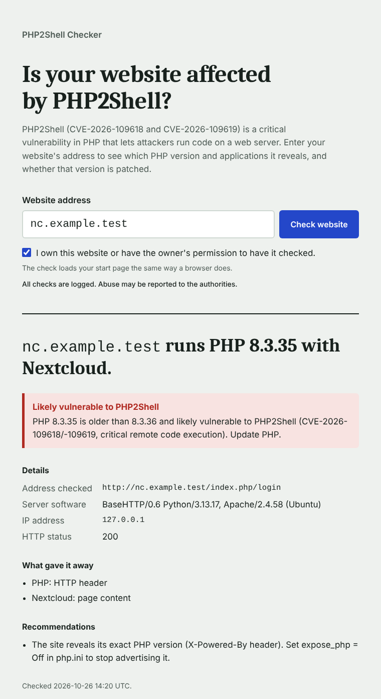

# php2scan

A self-hosted web page that checks whether a website is affected by **PHP2Shell**
(CVE-2026-109618 / CVE-2026-109619), the critical remote code execution
vulnerability in PHP.

Visitors enter a hostname and confirm they are allowed to check it. The service
loads the site's start page like a browser would and reports:

- whether the site runs PHP, and which version it reveals
- which PHP applications it uses (WordPress, Nextcloud, Joomla, TYPO3, Magento,
  phpMyAdmin and about 430 more)
- whether the visible PHP version includes the PHP2Shell fix
- what gave it away, and how to stop revealing it



## Run it with Docker

```bash
docker run -d --name php2scan --restart unless-stopped \
  -p 127.0.0.1:8088:8088 \
  -e CMSWEB_ORIGIN=https://scan.example.ch \
  -v php2scan-data:/data \
  ghcr.io/akaihigurashi/php2scan:latest
```

Or with Compose: download [`docker-compose.yml`](docker-compose.yml), set
`CMSWEB_ORIGIN` to your public address, then:

```bash
docker compose up -d
```

The container listens on port 8088 on localhost only. Put a reverse proxy with
TLS in front of it; an nginx example is in [`deploy/nginx-scan.conf`](deploy/nginx-scan.conf).

### Updates

```bash
docker compose pull && docker compose up -d
```

## Configuration

| Variable | Default | Purpose |
|---|---|---|
| `CMSWEB_ORIGIN` | – | Public address, e.g. `https://scan.example.ch`. Requests from other origins are refused. **Set it.** |
| `CMSWEB_OPERATOR` | – | Optional: name shown in a contact section at the bottom of the page |
| `CMSWEB_CONTACT` | – | Optional: contact e-mail shown in that section |
| `CMSWEB_IMPRINT_URL` | – | Optional link to an existing imprint page |
| `CMSWEB_TRUSTED_PROXY` | `127.0.0.1,::1` | Proxy addresses or networks whose `X-Real-IP` header is trusted |
| `CMSWEB_DENY_HOSTS` | – | Domains (incl. subdomains) that may never be checked, comma-separated |
| `CMSWEB_DENY_IPS` | – | Additional target IPs that may never be checked |
| `CMSWEB_AUDIT_DIR` | `/data/audit` | Daily audit log files |
| `CMSWEB_RETENTION_DAYS` | `30` | Audit files older than this are deleted |

In the Compose setup, nginx on the host reaches the container through the Docker
network gateway `172.30.250.1`, which is why that address is the trusted proxy.

## Abuse protection

- Visitors must confirm they are authorized; every check is logged with time,
  IP address, browser and the consent wording they accepted.
- Requests from VPNs, Tor, proxies and hosting networks are refused (public
  lists, refreshed automatically).
- Per-visitor rate limit and result caching. Limits are constants at the top of
  [`cmsweb.py`](cmsweb.py).
- Only hostnames are accepted. Every address they resolve to must be public, the
  connection is pinned to the checked address, and redirects are only followed on
  the same server, so the service can't be pointed at internal networks.
- Some websites are never checked: large well-known services, government and
  military sites, sites in or hosted in a list of countries, and the server the
  checker itself runs on (the domain from `CMSWEB_ORIGIN` and its addresses).
  The lists are at the top of [`cmsweb.py`](cmsweb.py).
- The container runs as an unprivileged user with a read-only filesystem.

### Handling misuse

1. Copy the relevant audit files before they expire:
   `docker compose cp php2scan:/data/audit/audit-2026-10-26.jsonl .`
2. Block the visitor at the reverse proxy if needed.
3. Report it to the visitor's network provider (`whois <ip> | grep -i abuse`) and,
   in Switzerland, to the Federal Office for Cyber Security
   ([ncsc.admin.ch](https://www.ncsc.admin.ch)) or the cantonal police.

## Command-line scanner

[`cmsscan.py`](cmsscan.py) is the detection engine behind the page and also works on
its own (Python 3, no dependencies) for checking your own servers: port scan, vhost
discovery and PHP/CMS fingerprinting.

```bash
python3 cmsscan.py 203.0.113.10
python3 cmsscan.py shop.example.ch@203.0.113.10
python3 cmsscan.py -h
```

Only scan systems you are authorized to test.

## Build it yourself

```bash
git clone https://github.com/akaihigurashi/php2scan.git
cd php2scan
docker build -t php2scan .
```

Every push to `main` builds the image for amd64 and arm64 and publishes it to the
GitHub Container Registry ([`.github/workflows/docker.yml`](.github/workflows/docker.yml)).

## License

GPL-3.0, see [LICENSE](LICENSE). The application fingerprints include data from
[webappanalyzer](https://github.com/enthec/webappanalyzer) (GPL-3.0).
